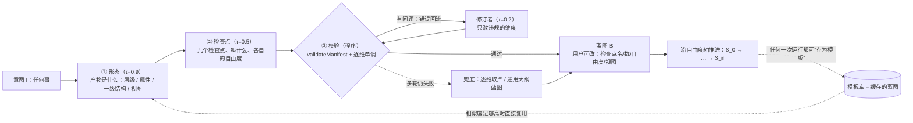
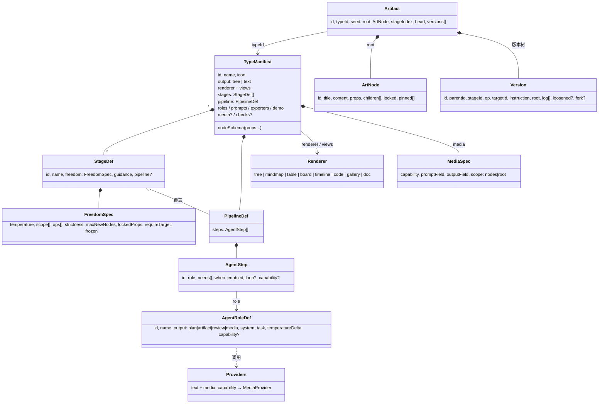
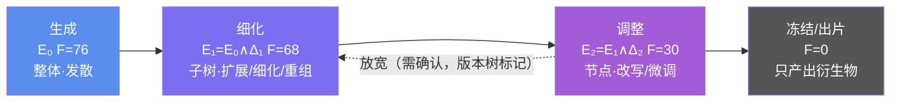
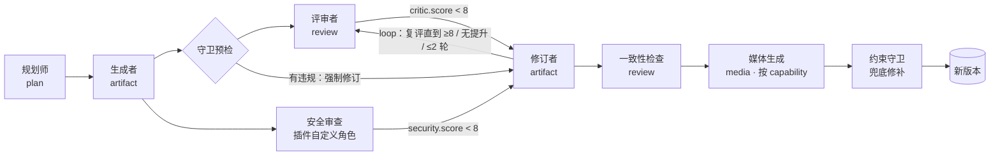
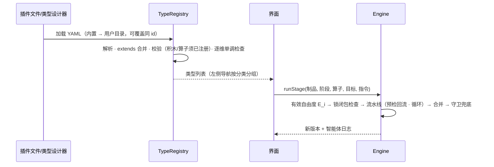
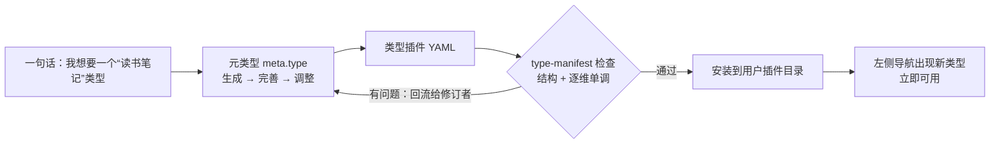
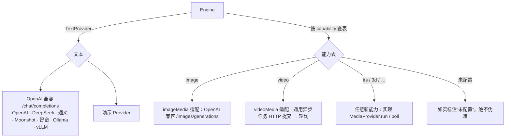

# 渐进 Refiner —— 抽象规划文档

> 一句话定位：**产品就是“由粗到细、自由度由高到低”这个过程本身**，与场景无关。你描述任何想做或想决定的事——一场婚礼、公司明年的战略、一首歌、一个数据库结构、一次旅行、一个研究问题——流程规划师即时推断出：产物的形态、检查点的数量与名称、每个检查点的自由度、每一步的智能体分工、合适的视图；然后由多个智能体在逐级收紧的自由度内把它从粗略推进到精细。
>
> 过去的“内容类型”（大纲、脑图、图片、视频、任务、计划……）**只是缓存下来的流程蓝图（模板）**：可选、可复用、可由任何一次运行另存，而不是导航，也不是能力边界。

版本：v1.3（2026-10-12；v1.1 吸收独立架构交叉评审，v1.2 统一离线矢量图标集，v1.3 上移一层抽象：过程即产品）　作者：GAOSICHUN / 多智能体协作设计

---

## A. 过程抽象（产品本身）

### A.1 形式化描述

一个工作 = 一个**过程** P = ⟨I, B, (S_t), (F_k), Ops, Agents, C⟩：

| 符号 | 含义 | 实现 |
|---|---|---|
| **I** | 意图：用户用自然语言描述的任何事 | `Artifact.seed` |
| **B** | 蓝图：由流程规划师从 I 推断（或取自模板）的过程定义 = 形态 + 检查点 + 自由度时间表 + 智能体分工 + 视图 | `TypeManifest`（制品自带 `Artifact.blueprint`） |
| **S_t** | 制品状态：一棵带属性的节点树（任何东西都是“整体 → 部分 → 细节”）；每次操作产生一个新状态，构成版本树 | `ArtNode` / `Version` |
| **c_0 … c_n** | 检查点：自由度轴上的命名点（名称、数量因事而异） | `StageDef[]` |
| **F_k** | 检查点 k 的自由度**向量**：温度 τ、作用域 σ ∈ {整体 ⊃ 子树 ⊃ 单节点}、可用算子集合 Ω、严格度 κ ∈ {宽松 < 遵守结构 < 严格}、新增上限 ν、锁定属性 Λ、是否必须选中目标 ρ、冻结 φ | `FreedomSpec` |
| **E_k** | 有效自由度：E_k = F_0 ∧ F_1 ∧ … ∧ F_k（∧ = 逐维取更严） | `effectiveFreedom` |
| **Ops** | 算子：generate ≻ expand ≻ restructure ≻ detail ≻ rewrite ≻ patch（按“改变能力”排序，可注册新算子） | `registerOp` |
| **Agents** | 智能体是算子的执行者：规划 → 生成 → 评审 ⇄ 修订（循环）→ 一致性 → 守卫 | `PipelineDef`（DAG + 条件边 + 循环） |
| **C** | 约束集合：锁定节点、用户手动编辑过的字段（自动固定）、锁定属性、选区外内容 | `locked` / `pinned` / `lockedProps` |

**过程的不变式**

1. **单调**：E_0 ⪰ E_1 ⪰ … ⪰ E_n（逐维偏序，由 meet 的构造保证；任何蓝图——人写的、模板的、模型生成的——都先过 `checkMonotonicStrict`，不满足就回流修订，最后兜底 `enforceMonotone`）。
2. **受限转移**：在检查点 k 上，一次操作 S_t → S_{t+1} 只能使用 op ∈ Ω(E_k)，只能触及作用域 σ(E_k) 内的目标，新增节点 ≤ ν(E_k)；超出部分由守卫还原或裁剪。
3. **约束单增**：C 只增不减——用户的每一次手动编辑都加入 C（`pinned`），锁定向下闭包；AI 的任何后续操作都不能违反 C（守卫强制）。
4. **显式放宽**：沿轴向左（回到更高自由度的检查点）是允许的，但必须确认，并在版本树上标为「放宽」分支，永不悄悄发生。
5. **可回溯**：每次转移都是版本树上的一个节点，可比较、可回滚、可分叉（多人设交叉设计 = 同一转移的多个兄弟分支 + 互评）。

### A.2 蓝图从哪里来：流程规划师（蓝图本身也由粗到细）



- 规划本身就是一个三步的“由粗到细”：先定形态（最自由），再定节奏（中等），最后只修违规（最不自由）。
- **核心不含任何场景知识**：`src/core/process.ts` 只做相似度统计、时间表构造、规范化、校验与回流；“婚礼需要日期、数据库需要字段”这类知识只来自规划智能体（真实模型），或演示模式下演示 Provider 的“形态线索”启发式（时间 / 数据结构 / 执行 / 创作 / 决策五类，没有线索就用通用大纲形态）。
- **从不失败**：模型输出乱码、抛错、或坚持给出放宽的时间表，最终都会得到一个合法、单调的蓝图（测试 `tests/process.test.ts` 用随机生成的、从未见过的意图验证这一点）。
- **模板相似度**：意图与模板的名称/描述做中文二元组覆盖率（去掉“设计、策划、一个”等无信息词），只用于推荐与演示模式下的复用判断；用户也可以在蓝图页一键“改用模板”。

### A.3 五个互不相关的场景映射到同一个过程

| 意图 | 形态（层级 · 属性 · 主视图） | 检查点（自由度 76 → 30） | 用户约束的典型用法 |
|---|---|---|---|
| 策划一场三天的团队建设 | 整体安排 → 时段 → 具体事项 · 开始/结束/负责人/状态 · 时间线 | 整体构想 → 日程骨架 → 细节安排 → 执行清单 | 锁定“第 2 天”的场地后，只让 AI 细化其余几天 |
| 设计一个微信小程序的数据库 | 整体 → 实体 → 字段 · 类型/必需/说明 · 表格 | 概念建模 → 结构细化 → 字段校准 | 手动改过的字段类型自动固定，AI 后续只能补说明 |
| 写一首关于秋天的歌 | 整体构思 → 段落 → 细节 · 情绪 · 文档 | 发散构思 → 成形 → 打磨 → 定稿 | 副歌一旦满意就锁定，后续只改主歌措辞 |
| 公司明年该不该进入东南亚市场 | 问题 → 选项 → 论据 · 依据/风险 · 脑图 | 发散选项 → 收敛比较 → 论证 → 决策定稿 | 开启多人设交叉设计：结构派/创意派/落地派各出一案并互评 |
| 研究：远程办公是否降低了创新 | 问题 → 选项 → 论据 · 依据/风险 · 脑图 | 发散选项 → 收敛比较 → 论证 → 决策定稿 | 在“论证”检查点只允许改写与补证据，不再新增假设 |

（以上为演示模式下实际得到的蓝图；接入真实模型时，形态与检查点由模型推断，同样经过校验与回流。原来的 9 个示例类型现在是模板库中的预设。）

### A.4 界面信息架构（v1.3）

- **左侧导航**：新的流程（万能输入）· 当前蓝图 · 模板库 · 项目与工作 · 模板编辑器 · 设置。不再按“内容类型分类”导航。
- **开始页**：一个输入框——描述任何事 → 「规划流程」。
- **蓝图页**：① 形态 ② 检查点与自由度（自由度轨道 + 逐检查点编辑温度/作用域/算子/严格度/新增上限，实时单调校验与“逐维取严”一键修复）③ 每个检查点的智能体分工；右侧是规划过程日志与「开始」「存为模板」「重新规划」。
- **工作页**：工具栏下方是**自由度轨道**——横轴是连续的自由度（左高右低），检查点是轴上的命名点，版本按所在检查点落在轴上；拖动当前位置向右 = 收紧进入下一检查点，向左 = 放宽（需确认，版本树标记）。
- **模板库**：模板卡片显示各检查点的有效自由度柱形；点开可“查看/修改蓝图”或“直接开始”。

---

## 0. 设计原则

| 原则 | 含义 | 在系统中的体现 |
|---|---|---|
| **抽象优先** | 核心不认识任何具体类型、任何具体模态 | `src/core/engine.ts` 不含“图片/视频”字面量（单测强制检查）；模态语义只存在于适配层 `providers/media.ts` |
| **过程即产品** | 产品是“由粗到细”的过程，而不是某几种内容 | 万能输入 → 流程规划师即时派生蓝图；模板只是缓存的蓝图（§A） |
| **声明式扩展** | 模板 = 一个 YAML 文件 | `plugins/*.yaml`；应用内「模板编辑器」可新建/编辑/安装；任何一次运行可“存为模板” |
| **自由度单调递减** | 每一步都比上一步更受约束 | 自由度是**多维约束**，逐维取严（meet）得到有效自由度 → 递减**由构造保证**；加载时逐维校验；运行时守卫；标量分只用于界面 |
| **用户越投入，越被尊重** | 手动改过的内容就是约束 | 手动编辑自动“固定”（图钉标记），守卫保证后续 AI 不会改回去 |
| **可寻址片段** | 任何子部分都可以被单独精化 | 统一节点树 `ArtNode`，文本型内容用“选区”寻址 |
| **多智能体交叉** | 生成者不自评；违规必须回流 | 流水线 DAG + 条件边 + 评审—修订循环（含停止条件）+ 守卫预检回流；发散阶段可开启**多人设交叉设计**（3 个方案互评，成为兄弟分支） |
| **一切可回溯** | 每次操作都是版本树上的一个节点 | 版本树 + 差异对比 + 回滚分叉 |
| **元层自举** | 引擎用同一流程设计自己的类型 | 元类型 `meta.type`：AI 生成类型插件 → 一键安装 |

---

## 1. 核心概念模型（下文中的“类型 / 插件 / manifest”即“蓝图 / 模板”）



| 概念 | 说明 |
|---|---|
| **Artifact 制品** | 被精化的对象：种子想法 + 当前内容树 + 当前阶段 + 版本树 |
| **ArtNode 片段** | 统一的可寻址节点：`title / content / props / children / locked / pinned`（pinned = 用户手动改过的字段）。树型内容天然是树；文本型内容（YAML、文章）是根节点的 `content`，用**字符选区**寻址 |
| **Stage 阶段** | 有序列表，**不固定为 3 个**（默认 生成→细化→调整；视频是 4 个，小说是 4 个） |
| **Freedom 自由度** | 每个阶段的约束向量，决定温度、作用域、可用算子、严格度、新增上限、锁定属性 |
| **Operation 算子** | 内置 `generate / expand / restructure / detail / rewrite / patch`，自由度由高到低；**算子注册表**：新算子声明 `权重 + 合并语义` 即可使用 |
| **Agent Role 智能体角色** | 规划师、生成者、评审者、修订者、一致性检查、媒体生成（按能力调用，不区分图片/视频），可在插件中新增（如“安全审查”） |
| **Pipeline 流水线** | 角色组成的 DAG，支持依赖 `needs`、条件边 `when`、循环 `loop`（直到达标 / 无提升 / 到上限） |
| **Provider** | 文本 Provider + **能力表** `media: { image, video, tts, … }`；类型用 `media.capability` 声明要哪种能力 |
| **Check 程序化检查** | 注册表中的校验函数（如 `type-manifest`），问题与守卫违规一起回流给修订者 |
| **Renderer / Editor / Exporter** | 可插拔视图积木，类型只“引用”积木 id |
| **Version 版本** | 每次操作产生一个版本节点；回滚 = 移动 head，下一次操作自动形成分支 |

---

## 2. TypeScript 契约（核心接口，摘自 `src/core/types.ts`）

```ts
interface ArtNode { id: string; title: string; content?: string;
  props?: Record<string, unknown>; children?: ArtNode[];
  locked?: boolean;            // 用户锁定：整棵子树不可改（祖先锁 → 运行前拒绝）
  pinned?: string[] }          // 用户手动改过的字段：'title' | 'content' | 'props.<key>'

type OpKind = 'generate' | 'expand' | 'restructure' | 'detail' | 'rewrite' | 'patch';  // + registerOp() 扩展
interface OpDef { id; label; desc; weight: number; merge: 'replace-root'|'append-children'|'keep-children'|'replace' }
type Scope = 'artifact' | 'subtree' | 'node';
type Strictness = 'loose' | 'schema' | 'strict';

interface FreedomSpec {
  temperature: number; scope: Scope[]; ops: OpKind[]; strictness: Strictness;
  maxNewNodes?: number; lockedProps?: string[]; requireTarget?: boolean; frozen?: boolean;
}
interface StageDef { id: string; name: string; description?: string;
  freedom: FreedomSpec; guidance?: string; pipeline?: PipelineDef;
  fork?: { personas: { id; name; brief }[] } }          // 多人设交叉设计（仅 generate）

interface AgentRoleDef { id: string; name: string; output: 'plan'|'artifact'|'review'|'media';
  system: string; task: string; temperatureDelta?: number; capability?: string }
interface AgentStep { id: string; role: string; needs?: string[]; when?: string; enabled?: boolean;
  capability?: string;
  loop?: { with: string; maxRounds?: number; until?: string; minGain?: number } }
interface PipelineDef { steps: AgentStep[] }

interface MediaSpec { capability: string; promptField?: string; outputField?: string;
  scope?: 'nodes' | 'root'; params?: Record<string, unknown>; paramProps?: Record<string, string> }

interface TypeManifest {
  id: string; name: string; icon?: string; category?: string; description?: string;
  extends?: string;                      // 继承另一个类型
  output: 'tree' | 'text'; language?: string;
  renderer: string; views?: string[]; rendererOptions?: Record<string, unknown>;   // 引用已注册的积木 id
  nodeSchema?: { props?: PropDef[]; maxDepth?: number; childLabel?: string };
  stages: StageDef[] | 'default';
  pipeline: PipelineDef;
  roles?: Record<string, Partial<AgentRoleDef>>;
  media?: MediaSpec; checks?: string[];  // 媒体能力声明；程序化检查（回流给修订者）
  prompts?: { domain?: string; format?: string };
  exporters?: string[]; actions?: string[]; demo?: { root?: ArtNode; text?: string };
}

interface TextProvider  { chat(req: ChatRequest, onDelta?, signal?): Promise<string> }
interface MediaProvider { run(req: { prompt; params?; meta? }): Promise<MediaResult>; poll?(jobId): Promise<MediaResult> }
interface Providers { text: TextProvider; media?: Record<string /* capability */, MediaProvider> }

// 引擎入口
function effectiveFreedom(stages: StageDef[], i: number): FreedomSpec;  // 逐维 meet
function runStage(req: RunRequest): Promise<RunResult>;                 // → 一个新版本
function runFork(req & { personas }): Promise<RunResult[]>;             // → 若干兄弟版本（交叉评分）
```

---

## 3. 自由度收窄的形式化：多维约束 + 逐维取严

> v1.1 修订（采纳交叉评审）：v1.0 只比较一个加权标量分，可以“放宽一维、用其他维抵消”。现在**自由度是一个多维约束向量，单调性逐维定义、由构造保证**；标量分只用于界面上的仪表与曲线。

### 3.1 维度与偏序

每个阶段声明一个增量约束 **Δ_i = (T, O, S, C, N, L, R, Z)**：

| 维度 | 含义 | “更严”的方向 |
|---|---|---|
| T 温度 | 采样温度 | 更小 |
| O 算子 | 允许的算子集合（每个算子有注册权重） | 最强算子权重更小 |
| S 作用域 | artifact(1) / subtree(.6) / node(.25) | 最宽作用域更窄 |
| C 严格度 | loose < schema < strict | 更严 |
| N 新增上限 | maxNewNodes | 更小（未设 = ∞） |
| L 锁定属性 | lockedProps | 集合更大 |
| R 必须选中 | requireTarget | 一旦开启向后继承 |
| Z 冻结 | frozen | 一旦冻结向后继承（冻结阶段本身不需要目标） |

### 3.2 有效自由度（运行时实际执行的约束）

**E_i = Δ_0 ∧ Δ_1 ∧ … ∧ Δ_i**，其中 ∧ 为逐维取更严者（温度取 min、L 取并集、N 取 min、C 取 max……；O、S 中超过前序上界的选项被剔除）。实现：`effectiveFreedom(stages, i)`，引擎、守卫、提示词与右侧面板全部使用它。

推论：**无论插件怎么写，E_0 ⊒ E_1 ⊒ … ⊒ E_n 恒成立**——前一阶段锁定的属性在后续阶段自动保持锁定（例如小说的 `pov`），后续阶段写高了温度也会被压回。

再叠加两类**来自内容本身**的约束：

- **锁闭包**：节点 `locked` → 整棵子树不可改；目标的任一祖先被锁 → **运行前直接拒绝**（不浪费一次调用）；被删除的锁定节点按原兄弟顺序插回。
- **用户编辑派生（pin，界面显示图钉标记）**：手动编辑时比较前后两棵树，把改过的字段记入 `node.pinned`。后续任何 AI 运行若改动这些字段，守卫还原并回流违规。唯一例外：用户**显式选中该节点**做「改写/微调」时，视为主动放开该节点的固定。

### 3.3 加载时校验

`checkMonotonicStrict(stages)` 逐维比较相邻阶段并指出“哪一维被放宽了”（例如 `阶段「调整」放宽了【新增上限】：4 → 不限`）。本次修订用它扫出并修复了 3 个内置插件的真实问题（图片、视频、小说的调整阶段未限制新增节点数）。校验结果为警告（插件仍可加载，因为运行时 meet 会自动收紧），类型设计器与元类型闭环会显示/回流这些警告。

### 3.4 界面用的标量分

`score(F) = 100 × (0.35·T̂ + 0.25·Ŝ + 0.25·Ô + 0.15·Ĉ)`（T̂ = T/1.2；Ŝ 最宽作用域权重；Ô 算子权重和 / 全部内置算子权重和；Ĉ = loose 1 / schema .55 / strict .15，有锁定属性 ×0.85、必须选中 ×0.8；冻结 = 0），**对有效自由度 E_i 计算**，仅用于仪表盘与自由度曲线。

默认三阶段：

| 阶段 | 温度 | 作用域 | 算子 | 严格度 | 其他 | 评分 |
|---|---|---|---|---|---|---|
| 生成 | 1.0 | 整体 | generate | 宽松 | — | **76** |
| 细化 | 0.7 | 整体/子树 | expand, detail, restructure | 遵守结构 | 新增≤30 | **68** |
| 调整 | 0.3 | 子树/节点 | rewrite, patch | 严格保持 | 新增≤5，必须选中 | **30** |

### 3.5 自由度如何被“执行”（不只是写在提示词里）

1. **提示词层**：`describeConstraints(E_i)` 把有效约束翻译成自然语言，含 [锁定] / [手动固定] 说明；
2. **调用层**：温度 = E_i.T + 角色偏移（评审者 −0.4、一致性 −0.6）；
3. **合并层**：按算子注册的合并语义只合并“目标子树”；文本型只替换选区字符；
4. **守卫预检（闭环）**：每次产出草稿后立刻“只检查不修补”，违规清单以「【约束守卫】」写入评审意见，**强制**后续修订者运行一次去纠正；
5. **守卫兜底**：锁定节点原位恢复、手动固定字段还原、锁定属性还原、超额新增裁剪、**严格模式下目标外变化一律还原**、枚举校验。

### 3.6 显式放宽

用户可以回到更早的阶段，但这是一次**有意识的放宽**：界面先确认“将从当前版本分叉”，引擎检测到“目标阶段早于 head 版本所在阶段”时，在新版本上标记 `loosened` 并在版本树上显示「放宽」徽标（回退箭头图标 + 文字，不改写版本名）。



---

## 4. 多智能体编排：可配置的图

每个阶段运行一张图（类型级默认，阶段可覆盖），节点是角色，边是 `needs`，条件边是 `when`，回边是 `loop`：



- **角色输出类型**决定它对状态的作用：`plan` 写入计划；`artifact` 产出/替换草稿（之后自动守卫预检）；`review` 产出 `{score, issues, suggestions}` 并累积到 `reviews`；`media` 按 `capability` 调用能力表中的 Provider。
- **条件语言**：`stepId.field op value`，支持 `|| &&`，例如 `critic.score < 8 || security.score < 8`。依赖步骤被跳过时条件为假。
- **评审—修订循环**：`loop: { with: critic, maxRounds: 2, until: "critic.score >= 8", minGain: 0.3 }`。停止原因（达标 / 无明显提升 / 到达上限 / 评分无效）写入日志「循环控制」。
- **评分规范化集中在一处**（`normalizeReview`）：无法解析、缺分、越界、“0 分却无问题”都被标为**评分无效**并在日志注明，**不再给默认分**去误触发修订。
- **多人设交叉设计**（发散阶段）：结构派 / 创意派 / 落地派各自独立生成一份方案（`{{persona}}` 注入生成者提示词），每份方案由**下一位人设**交叉评分（不自评），全部提交为版本树上的**兄弟分支**，head 指向最高分；用户在版本树里比较、切换、继续细化任意一支。类型可在 `stage.fork.personas` 自定义人设。
- 用户可在右侧面板逐个开关智能体；日志面板实时显示每个智能体的流式输出、评分、轮次与耗时。

---

## 5. 插件规范（类型 = 一个 YAML 文件）

```yaml
id: reading-notes            # 唯一 id
name: 读书笔记
icon: ri-book-2-line        # 图标名（Remix Icon，见 §7.1）；未知值/旧式 emoji 回退为默认图标
extends: outline             # 可选：继承另一个类型，只写差异
output: tree                 # tree | text
renderer: doc                # 默认视图积木
views: [tree, mindmap]       # 可切换视图
nodeSchema:
  childLabel: 笔记
  props:
    - { key: kind, label: 类别, type: enum, options: [摘要, 金句, 行动] }
stages:                      # 任意数量；或写 default
  - { id: generate, name: 速读, freedom: { temperature: 0.9, scope: [artifact], ops: [generate], strictness: loose } }
  - { id: refine,   name: 精读, freedom: { temperature: 0.6, scope: [artifact, subtree], ops: [expand, detail], strictness: schema } }
  - { id: adjust,   name: 内化, freedom: { temperature: 0.3, scope: [node], ops: [rewrite, patch], strictness: strict, requireTarget: true } }
roles:                       # 可选：新增/覆盖角色
  quote-checker: { name: 引文核对, output: review, system: ..., task: ... }
pipeline:
  steps:
    - { id: generator, role: generator }
    - { id: critic, role: critic, needs: [generator] }
    - { id: reviser, role: reviser, needs: [critic], when: "critic.score < 8",
        loop: { with: critic, maxRounds: 2, until: "critic.score >= 8" } }
media:                       # 可选：媒体能力（核心只认 capability 与字段名）
  { capability: image, promptField: prompt, outputField: url, scope: nodes }
checks: [type-manifest]      # 可选：程序化检查，问题回流给修订者
prompts: { domain: 领域知识与质量标准…, format: 额外输出要求… }
exporters: [markdown, json]
demo: { root: { title: "{{seed}}", children: [...] } }   # 演示模式样例
```

**生命周期**



插件存放：内置 `plugins/`（随应用打包）；用户 `%APPDATA%/渐进 Refiner/plugins/*.yaml`（类型设计器保存于此，可直接复制分享）。

---

## 6. 扩展点清单

| 扩展点 | 方式 | 需要改 `src/core` 吗 |
|---|---|---|
| 新内容类型 | 新增 YAML / 应用内类型设计器 / AI 生成（元类型） | 否 |
| 阶段数量、名称、自由度 | `stages`（任意长度；有效自由度自动 meet） | 否 |
| 智能体角色与提示词 | `roles` | 否 |
| 流水线拓扑、条件、循环 | `pipeline.steps`（`needs` / `when` / `loop`） | 否 |
| 多人设交叉设计 | `stage.fork.personas` 或界面开关 | 否 |
| 节点属性 schema | `nodeSchema.props` | 否 |
| 视图组合 | `renderer` + `views` + `rendererOptions` | 否 |
| 继承复用 | `extends` | 否 |
| **新模态（语音、3D、音乐…）** | `media: { capability: tts, … }` + 在能力表注册一个 `MediaProvider` | **否**（单测用一个“播客/tts”类型证明） |
| **新算子** | `registerOp({ id, weight, merge })` | **否**（注册即可，单测覆盖） |
| **新渲染积木** | 写一个组件并 `registerRenderers([...])` | **否**（核心只校验“已注册”） |
| **新程序化检查** | `registerCheck(id, name, fn)`，类型用 `checks:` 引用 | **否** |
| 导出格式 | `exporters`（markdown/json/csv/yaml/opml/svg/png/images/text） | 否（新增格式需注册一个导出函数） |
| 新模型服务 | 任何 OpenAI 兼容地址 | 否 |

---

## 7. 渲染积木（只做 8 个通用件，经注册表接入）

| 积木 | 数据视角 | 交互 |
|---|---|---|
| `tree` 大纲树 | 原生树 | 折叠、选中、行内编辑、增删、锁定（锁图标）、手动固定标记（图钉图标） |
| `mindmap` 脑图 | 树 → 水平思维导图（SVG） | 缩放、平移、点击选中、导出 SVG/PNG |
| `table` 表格 | 树 → 扁平行（列 = schema props） | 行内编辑属性、按分组显示 |
| `board` 看板 | 行按 `groupBy` 分列 | 拖拽卡片改变分组属性 |
| `timeline` 时间线 | 行 + start/end | 甘特条、今日线、里程碑 |
| `code` 代码 | 根节点文本 | CodeMirror、YAML/JSON 实时校验、选区即调整目标 |
| `gallery` 图库/分镜 | 子节点 + `media` 声明的提示词/输出字段 | 网格浏览、选中重绘；整片任务（`scope: root`）显示任务状态与轮询；字段名全部来自 manifest |
| `doc` 文档卡片 | 一级子节点 = 卡片 | 卡片式阅读、属性徽标 |

同一份数据可在多个积木间切换（例如任务：看板 ⇄ 表格 ⇄ 树）——这正是“数据统一为节点树”的收益。

### 7.1 图标规范（v1.2）

界面中的所有图标统一来自**离线内置的 Remix Icon 图标集**（v4.9.1，3229 个，线性/面性两种风格，统一 24 栅格与笔画），**不再使用 emoji 或文字符号充当图标**。

- **渲染方式**：图标集以 SVG 符号表（`src/renderer/icons/remixicon.symbol.svg`，即 iconfont 的 Symbol 用法）随应用打包，`<Icon name="ri-…"/>` 通过 `<use>` 引用。图形是矢量路径，由渲染引擎直接绘制，**不依赖系统字体或 emoji 字体**：Windows（含无彩色 emoji 字体的精简系统）、macOS、Linux、wine 下显示完全一致；颜色跟随文字（`currentColor`），尺寸按 `em` 与文字对齐。
  - 说明：最初按“图标字体”（woff2 + CSS 伪元素）接入，但在 wine 的 DirectWrite 下网页字体无法加载、仍显示方框；改为同一图标集的 SVG 符号形式后，所有环境一致，图标名与用法不变。
- **插件字段**：`icon` 写图标名，形如 `ri-book-open-line`（正则 `^ri-[a-z0-9]+(-[a-z0-9]+)*$`）。角色 `roles.<id>.icon` 同理。
- **向后兼容**：旧插件里的 emoji 或未知名称不会报错，校验给出警告“icon 不是图标名，将显示默认图标”，并回退为 `ri-file-list-3-line`（角色回退为 `ri-robot-2-line`）。
- **选择图标**：类型设计器工具栏「选择图标」打开图标选择器（按英文关键词搜索、线性/面性切换），点选即写入 YAML 的 `icon:` 行。
- **扩展**：渲染积木注册时也声明图标名（`registerRenderers` 的 `icon`）；新增角色、积木、检查都沿用同一图标名约定，无需改核心。
- **应用标志**：渐变方块中三条逐级收窄的横条（由粗到细），矢量绘制，不含文字；安装包图标 `build/icon.ico` 与之一致。
- **约束**：`tests/icons.test.ts` 检查全部插件与角色的 icon 都是存在的图标名、界面源码与插件中没有 emoji / 符号图标（正文中的“→”箭头属于标点，允许）、界面引用的图标名都存在、旧式 emoji 正确回退。

| 用途 | 图标 |
|---|---|
| 规划师 / 生成者 / 评审者 / 修订者 / 一致性 / 媒体 | `ri-compass-3-line` / `ri-quill-pen-line` / `ri-search-eye-line` / `ri-tools-line` / `ri-puzzle-line` / `ri-film-line` |
| 约束守卫 / 循环控制 / 交叉评审 | `ri-shield-check-line` / `ri-repeat-line` / `ri-team-line` |
| 锁定 / 手动固定 / 放宽 / 交叉方案 | `ri-lock-line` / `ri-pushpin-2-fill` / `ri-arrow-go-back-line` / `ri-git-branch-line` |

---

## 8. 9 个示例 + 未列出的类型如何映射到抽象层

**一句话：9 个示例只落在 5 种数据形态上**——这正是“抽象而非合集”的证据。

| 数据形态（IR 家族） | 结构 | 覆盖的类型 |
|---|---|---|
| ① 树文档 | 节点树，标题 + 正文 | 大纲、脑图、概念、周报、小说章节 |
| ② 带属性的树（记录集） | 节点树 + schema 属性 | 项目任务、功能清单、API 设计 |
| ③ 时间线 | 带属性的树 + start/end | 计划 |
| ④ 纯文本 + 选区 | 根节点 content | YAML、类型定义（元类型） |
| ⑤ 媒体规格 | 带属性的树 + `media` 声明 | 图片（每节点一张）、视频（整片一个任务） |

| # | 类型 | IR | 渲染积木 | 阶段（自由度递减） | 特殊配置 |
|---|---|---|---|---|---|
| 1 | 大纲 | ① | tree ⇄ mindmap ⇄ doc | 默认三阶段 | 5 角色流水线 + 评审修订循环 |
| 2 | 脑图 | ① | mindmap ⇄ tree | 发散 → 细化 → 收敛 | 无规划师，更高温度 |
| 3 | 图片 | ⑤ | gallery ⇄ table | 创意 → 细化 → 调整 | `media: {capability: image, scope: nodes}`；调整阶段锁定 `style`、不允许新增 |
| 4 | 视频 | ⑤ | gallery(分镜) ⇄ table ⇄ tree | 剧本 → 分镜 → 镜头调整 → **出片（frozen）** | `media: {capability: video, scope: root}`；未配置时只保留脚本，**不伪造视频** |
| 5 | 项目任务 | ② | board ⇄ table ⇄ tree | 默认 | schema：状态/优先级/负责人/估时；CSV 导出 |
| 6 | 计划 | ③ | timeline ⇄ table ⇄ tree | 默认 | schema：start/end/里程碑 |
| 7 | 功能清单 | ② | table ⇄ board ⇄ tree | 默认 | MoSCoW 优先级、工作量 |
| 8 | YAML | ④ | code | 生成 → 细化 → 调整（选区） | `output: text`，选区逐字保持 |
| 9 | 概念 | ① | doc ⇄ mindmap ⇄ tree | 萌芽 → 成形 → 定稿 | 卡片类别：定义/要素/示例/边界/类比 |
| + | **API 设计** | ② | table ⇄ tree ⇄ board | 默认 | **新增角色「安全审查」**，修订条件 `critic.score<8 \|\| security.score<8` |
| + | **小说章节** | ① | doc ⇄ tree ⇄ mindmap | 构思 → 情节 → 场景细写 → 润色 | 4 阶段；`lockedProps: [pov]` 经 meet 自动继承到润色阶段 |
| + | **周报** | ① | 继承大纲 | 继承 | `extends: outline`，整个插件 15 行 |
| + | **播客（测试中的示例）** | ⑤ | gallery | 默认 | `media: {capability: tts}`——新模态零核心改动 |
| + | **自定义类型** | 任意 | 所有视图 | 默认 | 通用起点 |
| ∞ | **类型定义（元类型）** | ④ | code(YAML) | 草拟类型 → 完善 → 调整 | `checks: [type-manifest]` + `actions: [installAsType]` |

---

## 9. 元层：用引擎设计引擎的类型



元类型声明了 `checks: [type-manifest]`：每次生成/修订后，引擎用 `parseManifest` + `checkMonotonicStrict` 校验草稿，错误与“哪一维放宽了”的警告作为「【约束守卫】」意见回流给修订者——这是一个真正的闭环，而不是“生成完再让用户自己去修”。

类型设计器还提供：从任意现有类型“复制为新类型”、YAML 实时校验、阶段有效自由度曲线预览、安装/卸载用户类型。

---

## 10. 数据模型与持久化

- 项目以 JSON 存于 `userData/projects/<id>.json`：`{ id, name, artifacts: Artifact[] }`，每个制品带完整版本树（含每个版本的智能体日志）。
- 设置存于 `userData/settings.json`；API Key 只保存在本机，不上传任何地方。
- 用户插件存于 `userData/plugins/*.yaml`。
- 版本树：`Version.parentId` 构成树；回滚只移动 `head`，下一次操作从该点分叉；连续手动编辑合并为一个版本；`loosened` 标记显式放宽分支；`fork` 记录多人设方案的组、人设与交叉评分。
- 手动编辑时自动计算被改字段写入 `node.pinned`（树形类型），可在属性面板一键取消固定。

## 11. Provider 抽象：文本 + 能力表



引擎里的媒体步骤只做三件事：按 `media.promptField` 读提示词 → 调 `providers.media[capability]` → 把结果写回 `media.outputField`（异步任务另写 `<字段>Status / Job / Message`）。“图片”“视频”的知识只存在于 `providers/media.ts` 这一层适配器里。

网络请求统一在 Electron 主进程发出（规避 CORS，Key 不暴露给网页环境），渲染进程通过 IPC 获得流式增量。

## 12. 界面信息架构（v1.2 及以前；v1.3 见 §A.4）

```
┌──────────────────────────────────────────────────────────────────────────┐
│ 标题栏：Logo · 项目名 · 演示模式徽标 · 主题切换 · 设置                        │
├────────┬──────────────────────────────────────────┬──────────────────────┤
│类型导航 │  工具栏：制品名 · 视图切换(树/脑图/表格…) · 导出 │ 阶段步进器（自由度条） │
│(按分类) │ ─────────────────────────────────────── │ 当前阶段：自由度仪表   │
│        │                                          │ 算子选择 · 作用对象    │
│项目/制品│        中央编辑区 / 预览（渲染积木）        │ 指令输入 · 运行/取消   │
│ 树      │                                          │ 智能体流水线开关       │
│        ├──────────────────────────────────────────┤                      │
│类型设计器│ 底部：智能体日志 | 版本树 + 差异 + 回滚      │ 选中节点属性检查器     │
└────────┴──────────────────────────────────────────┴──────────────────────┘
```

## 13. 多智能体交叉设计记录（本产品的设计过程）

| 角色 | 提出 | 被谁挑战 | 结论 |
|---|---|---|---|
| 架构师 | 9 个类型各自实现 | 评审者：“这只是 9 个生成器，不是抽象层” | 改为类型无关引擎 + 声明式插件 |
| 交互设计 | 固定三步按钮 | 一致性检查：“视频需要出片，小说需要情节阶段” | 阶段改为任意长度有序列表 |
| 算法 | 自由度只写进提示词 | 评审者：“模型不一定遵守” | 增加合并层 + 程序化约束守卫 |
| 产品 | 图片/视频直接调接口 | 评审者：“没有视频接口时不能假装有视频” | 视频走分镜 + 可配置任务接口，未配置明确显示状态 |
| 架构师 | 插件只能手写 | 产品：“用户不会写 YAML” | 元类型：用同一引擎让 AI 生成插件，一键安装 |

### 13.1 独立架构路 × 主线实现：交叉评审如何改变了设计（v1.1）

v1.0 完成后，另一位“架构师”智能体**在不看主线代码的情况下**独立做了一份架构设计，然后对照主线逐项评审（`交叉评审.md`）。它的结论是“方向正确、可交付”，但指出三处根本差距，以及若干具体缺陷。采纳情况如下：

| 评审意见 | 风险 | v1.1 处理 |
|---|---|---|
| 自由度只比较标量分，可“放宽一维、用其他维抵消” | 递减原则名存实亡 | **采纳**：多维约束 + `effectiveFreedom` 逐维 meet + `checkMonotonicStrict`；顺带扫出 3 个内置插件的真实问题并修复 |
| 用户手工编辑不产生约束，AI 下一轮会改回去 | 用户越投入越吃亏 | **采纳**：手动编辑自动固定（图钉标记），守卫强制保留；显式选中改写时放开 |
| 媒体知识泄漏进核心（`videographer`、`videoStatus` 写死） | “核心类型无关”说法不成立 | **采纳**：`manifest.media` + 能力表；`engine.ts` 零图片/视频字面量，单测强制 |
| 只检查目标锁，不检查祖先锁；恢复的锁定节点跑到末尾 | 浪费调用、顺序丢失 | **采纳**：运行前拒绝祖先锁；按原兄弟顺序插回 |
| 守卫只“静默修补”，智能体看不到自己违规；严格模式只警告 | 无闭环 | **采纳**：草稿后立即预检，违规回流并强制修订一次；严格模式目标外变化一律还原 |
| 评审—修订只走一次；解析失败默认 7 分误触发修订 | 无收敛、无诊断 | **采纳**：`loop` + 停止条件 + 日志原因；评分规范化集中，无效评分显式标注 |
| 回到前一阶段没有任何标记 | 自由度悄悄被重新打开 | **采纳**：确认对话框 + 版本 `loosened` + 「放宽」徽标 |
| 渲染器/算子白名单写死在核心 | 扩展要改核心 | **采纳**：渲染积木注册表、算子注册表（含合并语义）、检查注册表；元类型产物用 `parseManifest` 校验并回流 |
| “交叉”只体现为换温度，没有多方案 | 与“多个智能体交叉设计”的原话不符 | **采纳简化版**：多人设各出方案 → 交叉评分 → 版本树兄弟分支（复用现有版本树 UI） |
| 节点 `kind`、跨节点 `refs`、图片 img2img/局部重绘、资产外置、费用预算、并行执行 | 中期改动，风险较高 | **暂缓**，写入路线图（§14） |

评审也指出主线优于独立设计、应当保留的地方：8 个积木可在任意树形类型间切换；`spliceSelection` 对小模型复述全文/越界修改的鲁棒处理；“视频不造假”且演示模式走同一解析路径；`extends` 让周报只有 15 行；已经用真实本地模型端到端跑通并有 Windows 包。

## 13.2 刻意不做的东西（取舍）

| 不做 | 为什么 |
|---|---|
| 通用工作流引擎（任意节点类型、可视化编排器） | 流水线只需要 needs / when / loop 三种边；YAML 足以表达，可视化编辑器留到 v1.2 |
| 细粒度操作日志（insert/move/setProp）与 CRDT 协作 | 小模型“整子树重出 + 按算子语义合并”更稳；单机应用不需要实时协作 |
| 像素级图像编辑（mask、局部重绘） | 依赖具体服务能力；v1 只做提示词层面的收窄，并如实说明 |
| RAG / 知识库 | 与“由粗到细”主线正交，可作为一个角色插件接入 |
| 云同步与账号体系 | Key 和数据只留在本机是隐私承诺的一部分 |
| 每种类型一个专用编辑器 | 违背“类型 = 声明”的原则；8 个通用积木覆盖 5 种数据形态 |

## 14. 路线图

- **v1.0**：引擎、14 个插件、8 个渲染积木、类型设计器、多智能体 DAG、版本树、OpenAI 兼容 Provider、演示模式、Windows 便携版。
- **v1.1**：多维自由度 meet、用户编辑即约束（手动固定）、媒体能力表、守卫回流闭环、评审修订循环、显式放宽、注册表化、多人设交叉设计、元类型校验闭环。
- **v1.2**：界面图标统一为离线内置的 Remix Icon 矢量图标集（SVG 符号，不依赖 emoji 字体），插件 `icon` 改为图标名并兼容回退，类型设计器图标选择器，新应用标志。
- **v1.3（本次交付）**：抽象上移一层——过程即产品。万能输入 + 流程规划师（形态 → 检查点 → 校验/回流 → 兜底）即时派生蓝图；类型降级为模板库；自由度轨道作为工作页主轴（拖动收紧/放宽）；蓝图编辑器（检查点数量/名称/逐维自由度/视图）；任何运行可存为模板。
- **v1.4**：蓝图的对话式修改（“再加一个检查点专门做预算”）；规划师给出多套候选蓝图并互评；节点 `kind` 与按种类的 schema（`required`、类型、`maxDepth` 真正校验）；跨节点 `refs`（任务依赖、脑图跨枝连线）及“被引用即存在锁”；流水线可视化编辑器；费用估算与单次预算、同 prompt 缓存；无依赖步骤并行执行。
- **v1.4**：跨制品引用（计划引用功能清单、视频引用图片）；制品之间的“派生”关系（大纲 → 任务 → 计划）。
- **v1.5**：图像自由度落地（调整阶段复用 seed、以当前图为参考的 img2img、局部重绘；Provider 声明 `mapFreedom` 把温度映射为 strength）；图片资产外置为 `asset://hash`；视频按镜头分别生成并拼接；类型版本号与制品迁移；不可满足约束（unsat）检测。
- **v2.0**：插件市场（分享 YAML）、团队协作同步、本地模型一键管理（Ollama）。

---

## 15. 实现对照（v1.3 源码）

| 抽象 | 文件 | 说明 |
|---|---|---|
| 核心契约 | `src/core/types.ts` | 全部接口，零 UI 依赖 |
| 自由度形式化 | `src/core/freedom.ts` | 算子注册表、`effectiveFreedom` 逐维 meet、`checkMonotonicStrict`、界面评分、约束→自然语言 |
| 默认角色 / 阶段 / 流水线 | `src/core/roles.ts` | 6 个内置角色（含通用 media 角色）、默认循环、默认人设 |
| 引擎 | `src/core/engine.ts` | `runStage`：有效自由度 → 锁闭包 → DAG（预检回流、循环）→ 合并 → 守卫 → 版本；`runFork` 多人设；`runMedia` 通用媒体步骤 |
| 程序化检查 | `src/core/checks.ts` | 检查注册表（`type-manifest` 在 manifest.ts 注册） |
| 条件与模板 | `src/core/template.ts` | `{{var}}` / `{{#if}}` 模板，`when` 条件表达式 |
| 流程规划 | `src/core/process.ts` | `planProcess`（形态 → 检查点 → 校验回流 → 兜底）、`matchTemplates`、`buildSchedule`/`freedomAt`（n 个检查点的单调时间表）、`enforceMonotone`、`genericBlueprint`、`blueprintToTemplate`；不含任何场景知识 |
| 插件注册表 | `src/core/manifest.ts` | YAML 解析、`extends` 继承、校验（积木/算子须已注册）、渲染积木注册表 |
| 版本树 | `src/core/versions.ts` | 提交、手动编辑合并与手动固定、回滚分叉、差异 |
| Provider | `src/core/providers/openai.ts`、`media.ts`、`mock.ts` | OpenAI 兼容文本（SSE）/ 图像 / 通用视频任务；能力适配器；演示 Provider |
| 渲染积木 | `src/renderer/renderers/*` | 8 个通用积木，注册表 `index.tsx` |
| 图标 | `src/renderer/icons/*` | Remix Icon SVG 符号表、图标名表、`<Icon>` / `iconName` 回退 / `LogoMark` |
| 模板（缓存的蓝图） | `plugins/*.yaml` | 14 个预设 |
| 界面：过程 | `src/renderer/views/Home.tsx`、`Blueprint.tsx`、`Templates.tsx`、`components/FreedomTrack.tsx` | 万能输入、蓝图编辑、模板库、自由度轨道 |
| 测试 | `tests/engine.test.ts`、`tests/abstraction.test.ts`、`tests/icons.test.ts`、`tests/process.test.ts` | 56 个用例：流程规划（8 项：随机未见意图得到合法单调蓝图与第一阶段制品、6 个不相关意图得到不同过程、模板复用/指定、校验回流修订、乱码/抛错/固执模型兜底、任意检查点数的单调时间表、存为模板可重新加载）、图标规范（5 项）、插件校验、逐维单调与 meet、DAG、条件边、循环停止条件、守卫回流、严格还原、祖先锁、原位恢复、手动固定、放宽标记、多人设交叉、算子/检查注册表、新模态零核心改动、子树合并、选区严格保持、无伪造视频、版本分支、OpenAI 适配器（本地模拟服务器，流式 + 非流式） |

## 16. 关键决策记录（用户睡眠期间自主决定）

1. **产品名**：渐进 Refiner（“渐”取由粗到细之意）。
2. **技术栈**：Electron 33 + React 18 + TypeScript + Vite；核心引擎为纯 TS，可脱离 UI 单测、也可将来移植到服务端/CLI。
3. **统一数据模型 = 节点树**：所有树型内容共用一种结构，因此 8 个渲染积木可以在任意类型间复用和切换；文本型内容用“根节点文本 + 字符选区”统一寻址。
4. **自由度不仅写进提示词，还由程序强制**：有效自由度逐维取严，合并层只替换目标子树/选区，守卫预检回流 + 兜底修补。
9. **采纳交叉评审的 P0/P1 项、暂缓中期项**：凡可能破坏构建或需要新 UI 的（kind、refs、img2img、资产外置、预算、并行）只写进路线图。
5. **网络请求在主进程**：规避 CORS，API Key 不进入网页上下文。
6. **视频不造假**：未配置视频服务时，交付物是分镜脚本，界面明确显示“未生成视频”。
7. **演示模式**走与真实模型完全相同的解析/合并路径（它返回的是 JSON 文本而非对象），保证演示可信。
8. **Windows 打包**：在 Linux 上用 electron-builder + wine 交叉构建 NSIS 安装版、便携版、zip 三种形式。

## 17. 验证情况（v1.3 交付时）

| 项目 | 方式 | 结果 |
|---|---|---|
| 类型检查 | `tsc -p .` | 0 错误 |
| 单元测试 | vitest，56 项（见 §15） | 全部通过 |
| 真实大模型 | 本地 Ollama（qwen2.5-1.5B，OpenAI 兼容 `/v1`，SSE 流式）：大纲生成→扩展单章、YAML 生成→选区微调；Electron 界面内经 IPC 流式生成功能清单 | 端到端跑通，见《真实模型测试记录.md》与截图 13。真实运行中观察到：评审—修订循环因“评分无效”正确停止；一次运行中守卫预检发现 3 处枚举违规并回流给修订者 |
| 演示模式 | 万能输入、两个未见过主题的派生蓝图（团建 / 小程序数据库）、按蓝图推进并拖动自由度轨道、模板库；14 个模板 × 全部阶段脚本化巡检 + 手动固定与多人设场景，共 18 张截图 | 渲染器无控制台错误/警告 |
| Windows 包 | electron-builder（NSIS 安装包 / 便携版 / zip），v1.3.0 解包版在 wine（无 emoji 字体）中启动 | 新首页（万能输入、自由度轴）与图标全部正常显示，无方框（截图 00） |
| 图像/视频真实接口 | 仅代码路径与模拟服务器/假 Provider 逻辑，未接真实付费接口 | 待用户填入 Key 后验证 |

## 18. 产品 / 体验修正（v1.4，依据《产品评审-v1.3》）

**核心判断**：v1.3 能力完整但“工程师视角”——术语多、失败不可见、AI 改了什么看不出、主路径不明确。v1.4 不改动场景无关的过程内核，全部修正落在可用性层：失败可见可恢复、语言说人话、每一步只有一个明确的主动作、AI 的每处改动可审阅可撤销。

### 18.1 已采纳（P0 全部）
| # | 问题 | 决策 / 实现 |
|---|---|---|
| 1 | 垃圾输出被当成功（拒答文本成了根标题） | 引擎 `RunFailedError`（junk/empty）：生成者解析失败、拒答、无子节点即判失败，作品不改动；红色恢复条：重试 / 换个模型 / 查看原始回复 / 关闭。修订者返回垃圾时沿用上一稿并给出警告 |
| 2 | 报错是 HTTP 原文 | `core/errors.ts`：401/403/404/429/5xx/网络/超时/地址非法映射为中文原因 + 可展开详情；发请求前本地校验 Key 与地址；请求头 60 秒超时 |
| 3 | 主按钮含义不清，“重新生成”会覆盖一切 | 每步完成后主按钮「满意，进入下一步：X」，次按钮「不满意，重新生成（会替换全部）」；末步为「完成并导出」 |
| 4 | 术语（算子/作用域/评审者/F 值） | `renderer/terms.ts` 统一替换：往下展开 / 补充细节 / 调整结构；构思 / 撰写 / 检查 / 修改；自由度显示为 大胆 / 适中 / 克制 |
| 5 | 含糊意图直接生成，结果偏 | `clarifyIntent`：意图过短或含糊时先问 2–3 个问题（模型给出；失败回退到默认 3 问），可跳过；演示与真实模式均生效 |
| 6 | 看不出 AI 改了什么 | 改动高亮（新/改标记，悬停看改前内容与原因），全部保留/全部撤销，逐条保留/撤销，Ctrl+Z / Ctrl+Shift+Z |
| 7 | 示例在演示模式下是空泛模板 | 演示提供器内置三个精品样例（团建/小程序数据库/秋天的歌），带「演示样例」提示条；样例只存在于演示提供器，内核仍场景无关 |
| 8 | 测试成功后不知道还要关演示模式 | 连接测试三档（本地校验→连通→结构化探测），通过后提示「切换并保存」 |
| 9 | 重复出现两个“我的项目” | 根因：`projectsRef` 未同步更新；修复并在启动时合并空的重复项目 |

### 18.2 已采纳（信息架构与 P1）
- **简单 / 专家双模式**（默认简单）：简单模式隐藏自由度轨道、流水线、原始输出、模板编辑器、高级模型参数；专家模式保留 v1.3 全部能力。
- 进度卡「第 x/y 步 · AI 正在… · 已用 n 秒」，Esc 取消；简单模式日志不显示原始流。
- 每次改动的摘要（得分变化、发现的问题、轮次）与「为什么改」。
- 应用内中文对话框替代原生 confirm；删除项目/作品可在提示条撤销。
- 流水线状态只在对应步骤显示（不再串步）。
- 规划回退可见：黄色条说明原因，提供「换模型 / 重新规划」，徽标显示「通用流程」。
- 存为模板对话框（名称、说明、步骤预览，明确“只存流程不存内容”）。
- 导出新增：复制、Word（.docx，无依赖自实现）、OPML、PNG。
- 快捷键与帮助面板（?）；设置自动保存；模板编辑器移入专家模式；多方案并排对比并可逐部分采用。

### 18.3 暂缓（原因）
- Tab / Shift+Tab 缩进、Ctrl+K 命令面板、首次引导浏览：价值有但非阻断，排入 v1.5。
- 回收站（目前以撤销提示条替代）、超大树虚拟滚动、XMind 原生格式导出（OPML 可导入）。
- 评审中的 P2 项（协作、云同步、插件市场等）。
- 已知限制：小参数本地模型规划能力弱，常回退到通用流程（现已明确提示）。

### 18.4 验证（v1.4）
- 单元测试 vitest 全部通过（新增 `tests/v14.test.ts`：垃圾输出判失败、错误映射含适配器假 fetch、澄清流程、撤销/重做/逐条撤销与保留、演示样例）；tsc 无错误。
- 用本地“坏模型”服务 `scripts/fake-llm-server.js` 复测评审中的场景：垃圾输出 → 红色恢复条、作品未改动；401 → “API Key 无效或没有权限”；网络不通 → “无法连接到 127.0.0.1:9”；规划失败 → 黄色回退条（截图 21–25）。

## 19. v1.5 信息架构：引导式流程（依据《产品评审-v1.4-信息与流程》）

**问题**：v1.4 的零件都对，但同屏 7 个信息区、主按钮在 6 个不同位置、“当前步骤”出现 5 次、选中/作用范围/属性编辑分在三处且跨步骤残留。用户原话：“整体的信息有点不清晰，操作起来不顺畅”。

**原则**：一个工作区 + 一条固定位置的“下一步”操作栏 + 只在选中时出现的检查器。不加新功能，只重排信息与流程；内核（场景无关的过程引擎）不变。

### 19.1 布局
| 区域 | 内容 | 说明 |
|---|---|---|
| 标题栏 | 品牌、“已保存 · 时间”、演示徽标、专家开关、主题、设置 | 底部状态栏删除，保存状态移到这里 |
| 左栏 | 新建、模板库、我的项目（作品后缀 `2/4` / 完成 ✓） | < 1200px 自动收为 52px 图标条；“当前流程”导航项删除（确认步骤是工作区的一个状态） |
| 工具栏 | 项目 › 作品名（可改）、撤销 / 重做、历史、视图：大纲 ▾、导出 ▾（Word 在首位，末项“存为模板”） | 视图切换由 4 个无字图标改为带文字下拉 |
| 步骤条 | 唯一的步骤指示；已完成可点（悬停“回到这一步”，手型 + 下划线），跳过显示“—（已跳过）”；颜色从暖到冷；下方一行“这一步：……” | 删除标题胶囊、右栏步骤列表、“大胆━克制”色条 |
| 内容 | 渲染积木；属性合并为一行灰字（“待定 · 10/26–10/27 · 行政 · 王敏”） | 改动带「新/改」标记与逐条 ✓/↶ |
| 检查器 | 选中某项时从右侧浮出（320px，可 ✕），未选中不出现 | 专家模式仍在右栏 |
| 底部操作栏 | 左：将修改：全部 / 「X」（含 N 项）✕；审阅时为“AI 新增 a 处、修改 b 处（检查得分 x → y）‹ i/N › 为什么这样改？”。中：操作下拉 + 补充要求。右：AI 过程、再来一次 ▾ / 更多 ▾、**唯一的主按钮** | 简单与专家模式共用；运行中变为一行进度 + 红色“停止 Esc” |
| AI 过程 / 历史抽屉 | 默认收起；由操作栏“AI 过程”或工具栏“历史”打开 | 专家模式默认展开 |

### 19.2 状态机（`src/renderer/flow.ts`，纯函数，有单元测试）
`barModel()` 决定操作栏的模式与唯一主按钮：
- **ready**：`开始{步骤}` / `往下展开全部` / `往下展开「X」`；本步须先点选而未选时，主按钮为“跳过，进入下一步：X”（最后一步为“完成”），不出现禁用的蓝按钮。
- **running**：进度行 + 停止（红色，非蓝色主按钮）。
- **review**（有未审阅改动）：`全部保留，进入下一步：X`；逐条处理过则为“保留其余 N 处，进入下一步”；最后一步为“全部保留，完成”。`keepAndAdvance()` = 保留 + 进入下一步 + 清除选中，下一步默认作用于全部时**直接自动运行**（`canAutoRun()`）。
- **done** / **failed**（主按钮“重试”）/ **finished**（完成卡，主按钮为卡片上的“导出为 Word”）。
- `changeStage()`：切换步骤一律清除选中；`skipStage()` 记录 `artifact.skipped`。

### 19.3 其他调整
- 首页：副标题“想做什么？一句话告诉我，我们一步步把它做细。”；按钮“开始 →”；“继续上次的工作”紧贴输入框下方；说明卡只在还没有作品时显示。
- 澄清：输入框收为一行“意图 · 修改”，原“开始”按钮隐藏（同屏一个主按钮）；选项改为真按钮（边框、悬停、选中填充 + 勾、`role=radio`）。
- 确认步骤：主按钮移入底部栏；名称 / 项目 / 存为模板 / 重新规划收进“更多设置”；“为你定制”徽标与“规划过程”仅专家模式；强度标签改为左侧竖向渐变“AI 放得开 → AI 很克制”。
- 完成卡：全部 N 步已完成 · 部分 / 项数 / 用时 / 版本数；导出为 Word / 复制到剪贴板 / 其他格式；继续修改 · 存为模板 · 新建。
- 重开应用直接打开上次的作品，并提示“已为你打开上次的「X」· 回到首页”。
- 演示提示：只保留标题栏徽标 + 一次性可关闭的画布提示条（状态栏删除）。
- 日志里第二个“保护规则”（实为循环结束）改名“自动修改结束”；撤销后提示“已撤销：……”。
- 引擎：模型丢掉 id 时按同层同名沿用原 id（`reattachIds`），避免“补充细节”被误判为“删除 3 处 + 新增 3 处”。

### 19.4 验收（真实鼠标事件驱动构建产物，`REFINER_WIN=1280x800 / 1100x700`，结果见截图目录 `*-acceptance.json`）
| 标准 | 结果 |
|---|---|
| 4 步走完 ≤ 9 次点击，主按钮同一位置 | 首页 → 完成卡 **8 次**（+ 导出 Word = 9）；所有工作屏主按钮距右 16px、距底 15px（两种窗口尺寸一致）。若第 4 步再精修一项，+3 次 |
| 任何时刻只有一个蓝色主按钮 | 首页 / 澄清 / 确认 / 审阅 / 工作 / 完成卡各 1 个；运行中为 0 个蓝色 + 1 个红色“停止” |
| 当前第几步只出现一次 | 每个工作屏计数 = 1（步骤条） |
| 选中时操作栏写明“将修改：X”；切换步骤自动清除选中 | “将修改：「第 2 天 · 协作挑战」（含 3 项）”；进入下一步后 `selectedId` 为空 |
| 运行完成后无需滚动即可看到第一处改动 | 第 2、3 步审阅时第一处改动均在可视区内 |
| 1100×700 无重叠 | 标题栏 / 工具栏 / 步骤条 / 操作栏横向溢出 0px，子元素重叠 0 处 |

### 19.5 暂缓
- 首次使用 3 秒浮层引导（现以“没有作品时显示说明卡”替代）。
- 专家模式的自由度轨道在窄窗口下标签仍可能挤在一起；Tab 缩进、命令面板、回收站等 v1.4 已暂缓项继续暂缓。

## 20. v1.6 信息架构：真实可用 + 敢用（依据《UX补充功能-v1.5》《PM补充功能-v1.5》）

**主题**：v1.5 解决了“信息清楚、操作顺”；v1.6 解决“能接着真实工作做、改得动、看得见成本、不怕丢”。内核仍然场景无关：新增的导入、对比、费用、结构编辑全部是对通用节点树 / 通用流程的操作，不含任何场景知识。

### 20.1 闭环左端：从已有材料开始
| 环节 | 实现 |
|---|---|
| 入口 | 首页输入框下方“已经有草稿？从已有材料开始”：选择文件 / 拖文件进来（`import-zone`） |
| 解析（全部本地、纯 JS、随包离线） | `.docx` mammoth（Markdown + 纯文本）· `.pdf` pdf.js（按行重组文字层）· `.xlsx/.xls` SheetJS · `.csv` 内置解析 · `.xmind` JSZip 读 content.json（XMind 2020+）或 content.xml（XMind 8）· `.opml` / `.json` / `.yaml` / `.md` / `.txt` 内置。二进制库首次导入时按需加载（`src/renderer/extract.ts`，`ExtractLibs` 注入，浏览器版 / Node 版共用一套逻辑与测试） |
| 成树（`src/core/importers.ts`） | `markdownToTree`（标题层级 + 列表缩进，兼容本应用 Markdown 导出的 `> 属性` 行与 `- **标题**：说明`）、`paragraphsToTree`、`opmlToTree`、`xmindJsonToTree/xmindXmlToTree`、`dataToTree`（本应用 JSON `{type,seed,root}` / 任意 `{title|name, children|items}` / 任意 YAML 配置）、`rowsToTree`（兼容 CSV 导出的“层级/标题/说明”列；普通表格首列有重复值时按首列分组） |
| 规划 | 原文 → 参考资料；结构 → 可选“作为初稿”。规划师照常派生流程，`pickStartStage()` 按细化程度（深度、节点数、有说明/属性的比例）映射到自由度相当的步骤，至少留一步可做；确认页写明理由（“已有 2 层、10 项，20% 已有具体说明，从「日程骨架」接着做”）。初稿以 `manual` 版本“导入「文件名」”落在所选步骤，不自动运行 |
| 往返 | OPML / JSON / YAML / Markdown 导出 → 再导入，结构、说明、属性一致（单元测试覆盖） |

### 20.2 参考资料（每个作品）
`artifact.refs[]`（文件 / 文字 / 网址）。`refContext()` 按 12,000 字预算拼接，逐份记录截断；`RunRequest.references` 由引擎追加到**每个调用模型步骤的系统消息**（“优先采用其中的事实与约束”）。网址由主进程抓取并去标签（15 秒超时，失败只记网址）。面板显示用量条、每份“只发送前 N 字（已截断）”、可停用。

### 20.3 直接编辑
- 大纲：单击标题即编辑；Enter 新建同级、Tab / Shift+Tab 缩进 / 提升、空行 Backspace 删除、Esc 结束；选中后 F2 / Enter 编辑、Delete 删除、Tab 调层级。编辑中的结构动作与标题提交合成**一个版本**。
- 拖拽：自研指针拖拽（`renderers/drag.tsx`，不用 HTML5 DnD——触控板与合成输入下都可靠）。落点按行内纵向位置：上 28% 前 / 下 28% 后 / 中间成为子项；不能拖进自己的子孙。大纲、看板（跨列 = 改分组属性，落在卡片上同时排序）、表格（行首把手）三处一致。纯函数 `moveNode / reorderSibling / indentNode / outdentNode / insertSiblingAfter / dropPosFor`（`src/core/treeops.ts`）。
- 撤销：手动编辑只在**同一标签**的连续编辑间合并（8 秒内），每个操作带具体标签（“移动「X」到「Y」前”“删除「X」”“缩进「X」”），撤销提示据此写明撤销了什么。
- 焦点环：全局 `:focus-visible` 2px 主色。Esc 层级（`src/renderer/esc.ts`）：运行中 → 停止；否则 浮层（菜单 / 范围选择 / “为什么”）→ 面板（AI 过程 / 历史 / 资料）→ 取消选中。

### 20.4 信任与控制
- **下一步不自动运行**：`keepAndAdvance(a, m, now, autoRunSetting=false)`；进入下一步后停在准备态，操作栏左侧为可点的「将修改：全部 ▾」，下拉列出“全部 / 只改「各一级部分」”，也可在内容里点选。设置“进入下一步时自动开始”（默认关）。
- **运行反馈**：开始即显示骨架行；流式时 `partialTree()`（jsonrepair 修补半截 JSON）把已生成的部分逐步渲染；演示模式的模拟服务同样分块输出。
- **并排对比**（`components/Compare.tsx` + `core/compare.ts`）：任意两个版本 / 分支（顶部两个下拉可换；历史里勾选两版；审阅时“与上一版并排对比”）。`alignParts()` 按 id、再按规范化标题对齐一级部分；`subtreeStatus()` 一一对应（重复标题不被重复认领）；属性显示为“负责人：王敏 · 状态：已确认”；改动项内 `wordDiff()`（中文按字、英文按词，合并碎片）。每部分「用这一版」（这一侧没有该部分 = 从当前去掉），以及「整版用这一版」。历史面板的原始文本 diff 改为同样的结构化改动清单。

### 20.5 成本可见（`src/core/cost.ts`）
- 计量：`createMeter()` 包住文本 Provider；每次调用先按字数估算（中日韩 1 字≈1 token，其余 4 字符≈1 token），服务商返回 `usage`（非流式响应或流式末块）时以真实值覆盖。版本记录 `usage`，作品累计 `artifact.usage`（失败 / 取消也计入）。
- 价目表：预置 DeepSeek / 通义 / Kimi / 智谱 / 豆包 / 混元 / OpenAI / Claude / Gemini（元 / 百万 tokens，最长前缀匹配，用户可改、可为任意模型单独设价）；未知模型显示“未设价格”。
- 预估：`runEstimate()` = 流水线调用次数（含循环上限）×（提示开销 + 当前内容 + 参考资料），显示在主按钮左侧。
- 预算：单次 / 每作品上限，`checkBudget()` 拦截并以对话框说明原因与出路。

### 20.6 底线能力
- **自动备份**（`src/main/backup.ts`）：每日首次启动、删除项目前、恢复前；`backups/<时间>-<原因>/`（projects + settings + backup.json），保留最近 N 份；恢复先做“恢复前”备份再覆盖 projects（设置保留当前，避免把 Key 恢复成旧值），然后重新加载。
- **API Key 加密**（`src/main/secrets.ts`）：写盘时所有 `apiKey` 字段 → `enc:v1:<base64>`（Electron safeStorage，Windows DPAPI）；读盘解密；发现旧版明文立即加密回写（迁移）；加密不可用（如 Linux 无密钥环）时保持明文并在设置页说明；损坏密文不崩溃（置空）。
- **自动更新**：electron-updater generic 源，地址在设置里配置（`setFeedURL` 运行时设置，打包配置里的占位地址仅用于生成 latest.yml）。检查 20 秒超时，所有错误转为“连不上更新地址（…）”，不抛出、不崩溃。发布方法见《使用说明》§12。
- **界面缩放**：Ctrl+= / Ctrl+- / Ctrl+0（`webContents.setZoomFactor`，0.8–1.6），设置页可选，持久化。

### 20.7 验证（v1.6.0 交付时）
- 单元测试 105 个全部通过（新增 25 个：结构编辑 4、不自动运行 1、费用 4、导入 9（含真实 docx / pdf / xlsx / xmind 文件）、参考资料 2、对比 1、流式 1、加密迁移 2、备份恢复 2）。
- 构建后的应用由真实鼠标 / 键盘 / 拖拽事件驱动（`REFINER_TOUR=v16`，记录 `截图/1280x800-v16.json`）：导入 4 种真实文件并按规划师选择的步骤打开；单击编辑、Enter 新建同级、Tab 缩进、Shift+Tab 提升、F2、Delete + “已撤销：删除「…」”；大纲排序与移入子项、看板跨列、表格行排序均生效且可撤销；骨架与流式都出现；下一步停在“将修改：全部”；Esc 依次关闭菜单 → 面板 → 选择；并排对比无 `{key:…}` 机器格式、改动项内有字级差异、“用这一版”生效；预算上限拦截；不可达的更新地址只给提示；Ctrl+= 缩放生效。v1.5 主流程验收重跑：同屏一个主按钮、无溢出 / 重叠；从首页到完成卡由 8 次点击变为 9 次（多出的一次就是“下一步先确认范围”，是有意的）。

### 20.8 路线图：剩余的 UX / PM 项
**下一版 v1.7（约 1–2 周，主题：“看得懂改动 + 接入工作流”）**
- UX A3 改动先以草稿层预览再落地；A5 每处改动的原因（修订者输出 reason，徽标悬停“因为…”）；A6 指令建议。
- UX B3 多选与批量（Ctrl/Shift 点选，“将修改：3 个部分”，批量锁定 / 改状态）；B4 剩余部分：roving tabindex 树（←→ 折叠展开、空格多选）、Ctrl+K 命令面板；B5 检查器在 ≥1200px 推开内容、窄窗口改底部抽屉。
- UX D1 首次进入工作屏 3 步引导；E2/F1 失败就地恢复与 toast 统一；G1/G3 ARIA 语义与对比度；I1 模型列表下拉。
- PM C1 导出增强（.xmind 原生、Excel、Mermaid / 甘特、HTML）；B2 项目记忆（术语、固定事实）；D2 每月预算与降级；D3 按角色分配模型；D5 国内服务商补齐（豆包 / 文心 / 混元 / MiniMax / 阶跃）；H4 规划误套检测；A3 粘贴长文 / 网址直接开始；G3 发送前脱敏。

**1 个月（v1.8）**：PM C2 飞书 / 钉钉推送；C3 Notion / Jira / GitHub Issues（先 2 个）；C5 输出校验器（YAML / JSON Schema）；B4 作品派生（大纲 → 任务 → 计划，上游改动提示下游）；E2 搜索；E3 回收站；E5 批量重跑；F1 打包分享；I2 代码签名；I3 崩溃上报；PPT 导出。UX C2 历史时间线人性化 + 版本预览、H1 专家模式窄窗口、J 日期本地化与虚拟滚动。

**3 个月（v2.0）**：本地 RAG（参考资料多时自动挑片段，替代当前的固定预算截断）、Git 写回、Ollama 管理、CLI / API、只读分享页、模板市场、团队空间与同步目录、多语言、macOS 版、媒体真实服务接入。

**刻意不做**（沿用 PM 建议）：通用聊天 / 智能体市场、实时多人协同编辑、自研模型。


## 21. v1.7 深度优化：由粗到细看得见、改得准（依据《深度优化-v1.6》）

### 21.1 已修复的问题
- **范围漂移（P0）**：只改某一部分时，修订者只看到目标及其祖先链与同级标题；输出若越出目标子树则自动截取目标子树，截不出则保留原稿并提示（`scopeDrift` / `ancestryText`，有回归测试）。
- **重新规划丢失导入初稿**：重新规划保留导入的结构初稿（`replanOpts`）。
- **修订变差**：评审打分下降时保留得分更高的版本，并在历史中注明“修订未改善（a → b）”。
- **澄清答案混进标题**：标题保持原意图，答案作为“固定事实”保存，后面每一步都遵守。

### 21.2 新能力
- **成熟度**：每个部分有 粗/中/细 色点（悬停显示原因：说明太短、含“待定”、缺属性、数值为推断）；标题旁显示就绪度 %；底部条列出最粗的地方，“接着细化最粗的 3 处”一次运行多个目标，合并为一个版本。
- **主操作**：第 2 步起主按钮为“往下展开全部 →”，“跳过这一步”移到“更多”。
- **选中与编辑**：单击选中，双击或 F2 编辑；检查器显示“选中：「…」”与成熟度。
- **数字字段**：从说明中提取金额（支持 万、另计/+ 相加，排除单价），标“推断”；表格/大纲显示小计、合计与预算对比，超预算标红。
- **导入理解**：Word 表格变成条目；待定/TODO/？ 变成“待澄清的问题”；不再把乱草稿报告为 100% 详细。
- **步骤间追问**：评审发现缺事实时，下一步前用卡片询问，回答成为固定事实。
- **交接清单**：完成卡列出待定项、缺字段、下一步行动，可导出 CSV 待办 / ICS 日历。
- **以此为基础新建**：概念 → 功能清单 → 任务 / 执行计划；下游显示“来自：上游”链接，上游有修改时提示更新参考资料（不自动改动已生成内容）。
- 设置中模型可从服务端列表下拉选择；标题栏模型徽标过长时省略。

### 21.3 推迟到后续版本
- A3 草稿层（AI 改动先进草稿，逐条接受）；A5 每处修改的理由。
- B3 界面多选目标；B5 检查器推开而非覆盖。
- D1 首次使用引导。
- 更多导出格式（Markdown 表格 / 飞书 / Notion）与第三方集成（任务系统、日历同步）。
- 上游变更后的下游“三方合并”。


## 21. v1.7 深度优化（依据《深度优化-v1.6》）

### 21.1 已完成
1. **范围守卫**：定点修改时修订者只看到目标及其祖先链（+兄弟标题）；输出越界时只取目标子树，取不到则保留原稿；回归测试见 `tests/v17.test.ts`。
2. **重新规划保留导入初稿**（replanOpts）。
3. **第 2 步起主按钮“往下展开全部 →”**，“跳过这一步”移入「更多」。
4. **成熟度**：每个部分 粗/中/细 色点（悬停看原因）、标题旁就绪度 %、底部“还有 N 处比较粗”条与「接着细化最粗的 3 处」（多目标顺序运行，合并为 1 个版本，可整体撤销）。
5. **数字字段**：从说明中提取金额（标“推断”）、表格/大纲小计与合计、对比预算（来自根节点或“预算”事实），超支标红。
6. **修订变差时保留得分更高的版本**并说明。
7. **澄清回答不再拼进标题**，成为“固定事实”；单击选中、双击/F2 编辑；检查器显示“选中：「…」”。
8. **导入理解**：Word 表格→条目；待定/TODO/? → “待澄清的问题”；就绪度如实统计。
9. **以此为基础新建**：概念→功能清单→任务/执行计划；下游显示“来自：…”可跳回；上游更新后下游提示“更新参考资料”。
10. **步骤间追问**：检查者发现缺事实时弹出“AI 想先确认 N 件事”，回答成为固定事实。
11. **完成卡交接清单**：还没定的、缺字段、下一步行动；导出 CSV 待办 / ICS 日历。
12. 设置中模型列表下拉（读取 /models）；标题栏模型徽标超长省略。

### 21.2 延后（路线图）
- A3 草稿层（AI 改动先进草稿再合并）；A5 每处改动附理由。
- B3 界面多选目标；B5 检查器推开而非覆盖。
- D1 首次使用引导；更多导出格式（Markdown 表格/飞书/Notion）；与任务工具（Jira/飞书项目）集成。
- 多目标运行并行化与逐处确认。


## 22. v1.8 自进化第 1 轮：审阅可信、多选、首次引导

依据《自进化-第1轮》。对照 ChatGPT Canvas / Gamma / Plandex / STORM。

1. **逐条改动理由**：每处「新」「改」下方显示为什么改；优先模型 `why`，否则对比改前改后 + 关联检查意见。
2. **Ctrl+单击多选**：主按钮“处理所选 N 处”，合成一个版本。
3. **首次引导**：就地 3 条（先粗后细 / 点哪改哪 / 每处都有理由）。
4. **检查器推开内容**（并排，不再覆盖）。

## 23. v1.9 自进化第 2 轮：并行细化、粒度双向、追问卡收起

依据《自进化-第2轮》。对照 LangGraph Send / gpt-researcher / Sudowrite / Heptabase / Canvas 长度滑杆。

1. **`runStageMulti` map-reduce**：默认 3 路并行（可设置），延迟汇总，失败隔离，重叠目标只留外层。
2. **检查器粒度**：更粗 / N 个子项 / 更细（只用本步允许的算子）。
3. **追问卡**：矮窗口默认一行。

## 24. v2.0 自进化第 3 轮：从撤回中学习、开放导出

依据《自进化-第3轮》。对照 Cursor Bugbot/Memories、DSPy GEPA、JSON Canvas、Mermaid。

1. **偏好**：撤回 → 记一句偏好 → 每步【用户偏好】约束；可停用。
2. **导出 JSON Canvas（.canvas）与 Mermaid（.mmd）**。
3. **空改动诚实反馈**。

### 24.1 仍延后
- 草稿层侧栏 diff；STORM 多视角；账号型集成；逐处确认；偏好作用域。


## 25. v2.1 自进化第 4 轮：草稿层侧栏、逐处确认

依据《自进化-第4轮》。对照 v2.0 §24.1 延后项中「信任与控制」优先级最高的两项。

1. **草稿层侧栏**：待审阅改动收成右侧「改动清单」（新/改/删 + 改前改后 + 理由 + 保留/撤回 + 点击跳转）。`draftItems` / `draftItemsBetween`。
2. **逐处确认**：设置「多处细化时逐处确认」。`runStageConfirming` 每处暂停，保留或撤回后再继续，最后合成一个已审阅版本。

### 25.1 仍延后
- STORM 多视角预写作；偏好作用域与导入/导出；本地导出包（HTML / 交接 zip）；账号型集成。

## 26. v2.2 自进化第 5 轮：偏好作用域、多视角预写作

依据《自进化-第5轮》。对照 STORM 多视角（本地、不检索）与第 4 轮 §25.1 延后项。

1. **偏好作用域**：`Pref.scope` 为 `work`（仅本作品）或 `global`（所有作品）；`effectivePrefs` 合并后写入【用户偏好】。面板可提升/降级，可导出/导入 JSON。
2. **多视角预写作**：第一次铺整体前增加 survey 步（执行者 / 审查者 / 使用者），备忘注入生成提示并显示为作品上的「多视角备忘」卡。设置「第一次铺整体前先多角度看一看」，默认开；失败跳过。

### 26.1 仍延后
- 本地导出包（HTML / Markdown 表格 / 交接 zip）；账号型集成；上游变更三方合并。

## 27. v2.3 自进化第 6 轮：本地交接导出包

依据《自进化-第6轮》。对照 §26.1 延后项中「不必接账号、对交接最有用」的本地导出。

1. **网页 HTML**：自包含、系统字体、可离线打开/打印；转义特殊字符；含就绪度与 Mermaid 源。
2. **Markdown 表格**：按一级部分分表，含类型属性列。
3. **交接包 zip**：HTML + 表格 + JSON Canvas + Mermaid + 说明（及大纲/CSV），一次带走。

### 27.1 仍延后
- 账号型集成（Jira/飞书）；上游变更三方合并；首次引导深化；HTML 内嵌可视化图（现只附 Mermaid 源）。
## 28. v2.4 自进化第 7 轮：数据可靠性：原子写入与损坏恢复

依据《自进化-第7轮》。

新增 `src/core/persist.ts`：`atomicWrite`（写临时文件、fsync、再替换）、Windows 下经 `.bak` 互换、`loadJsonFile` / `loadJsonDir` 从 `.tmp`/`.bak` 恢复并写回主文件。主进程的项目保存、设置、插件写入改为原子写；加载项目走 `loadJsonDir`。

## 29. v2.5 自进化第 8 轮：备份恢复事务化

依据《自进化-第8轮》。

`replaceDir`：先拷到 `projects.next`，再把旧目录挪到 `projects.prev`，最后改名为 `projects`；失败则尽量挪回。`restoreBackup` 改用它。缺 `projects` 的备份不进列表。`backup.json` 改为原子写。

## 30. v2.6 自进化第 9 轮：长任务取消时保留已完成部分

依据《自进化-第9轮》。

取消时若已有成功结果，则合并这些部分并返回版本，标记 `partial`，警告写清“已停止：已保留 N 处，未处理 M 处”。一处都没完成仍抛出「已取消」。

## 31. v2.7 自进化第 10 轮：长任务检查点（崩溃/退出后可恢复）

依据《自进化-第10轮》。

每完成一处通过 `onCheckpoint` 把已合并的树写到作品的 `runJournal`（随项目原子保存）。提供 `hasPendingCheckpoint` / `applyCheckpoint` / `discardCheckpoint`。应用后提交一个 partial 版本并清日记。成功跑完会清掉日记。

## 32. v2.8 自进化第 11 轮：逐处确认中途取消保留已确认项

依据《自进化-第11轮》。

已有保留时 abort 不再丢弃，返回已确认部分并标 `partial`。中途停止（未处理完所有目标）同样标记。一处都没保留仍抛「已取消」。

## 33. v2.9 自进化第 12 轮：上游变更三方合并

依据《自进化-第12轮》。

`mergeTrees(base, ours, theirs)`：只改上游的吸收，只改下游的保留，两边都改且不同则保留己方并写下 `conflict`。下游删掉的旧节点不自动恢复。作品上增加「合并上游改动」，参考资料仍会更新。

## 34. v2.10 自进化第 13 轮：交接包可再导入与往返

依据《自进化-第13轮》。

`fromJSONCanvas` 与 `importPackFiles`：优先 `board.canvas`，否则 `outline.md` / `table.md`。与 `packFiles` 往返可找回标题和父子关系。

## 35. v2.11 自进化第 14 轮：恢复与部分完成的中文说明

依据《自进化-第14轮》。

`recoveryNotices` 把上述情况收成可展示的通知。作品页出现「补成一个版本 / 丢掉」条；部分完成的运行也有一句说明。

## 36. v2.12 自进化第 15 轮：可访问性：图标按钮名称与对话框角色

依据《自进化-第15轮》。

为 icon-btn 补上 `aria-label`（与 title 一致）。确认对话框加上 `role=dialog`、`aria-modal`、`aria-labelledby`，确定按钮保持 autoFocus，Esc/Enter 仍可用。

## 37. v2.13 自进化第 16 轮：运行时有效自由度收紧的正确回退

依据《自进化-第16轮》。

空列表时改为回退到不超过上限的合法算子/作用域（没有则 `patch` / `node`）。`freedomTightened` / `freedomRuntimeNote` 用中文说明哪一维被收紧；自由度轨道在非紧凑模式下显示这句说明。


### 37.1 仍延后
- 账号型集成（Jira/飞书）继续不做。
- 交接 HTML 仍只附 Mermaid 源，不内嵌前端图库。
- 首次引导深化；首次铺开时草稿层仍不逐条高亮。
- 从交接包导入的界面入口（引擎层已可导入，完整拖放 zip 的操作入口可再补）。
- 本机真实 Windows 桌面全 E2E（本次用单元/集成测试与类型检查验证；未用 Shell 驱动桌面）。
